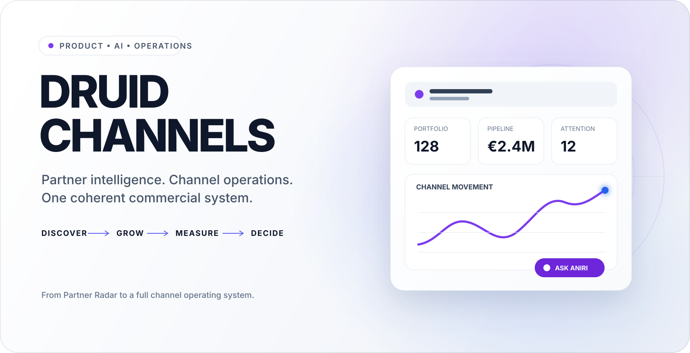
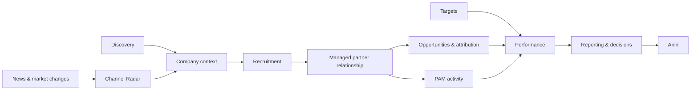
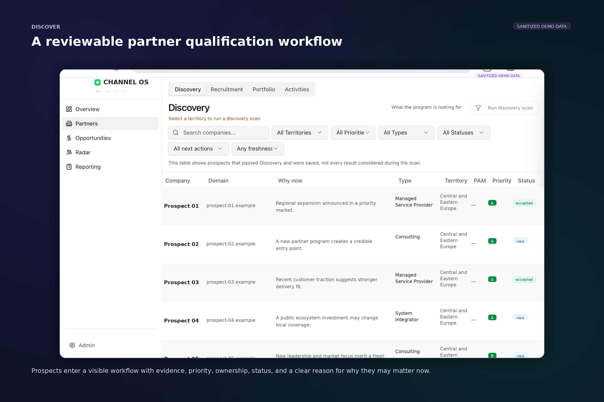
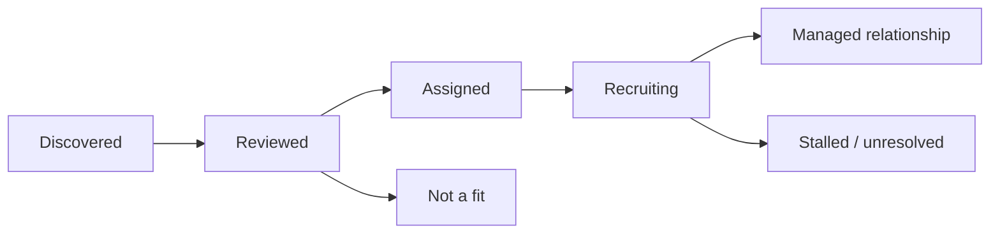
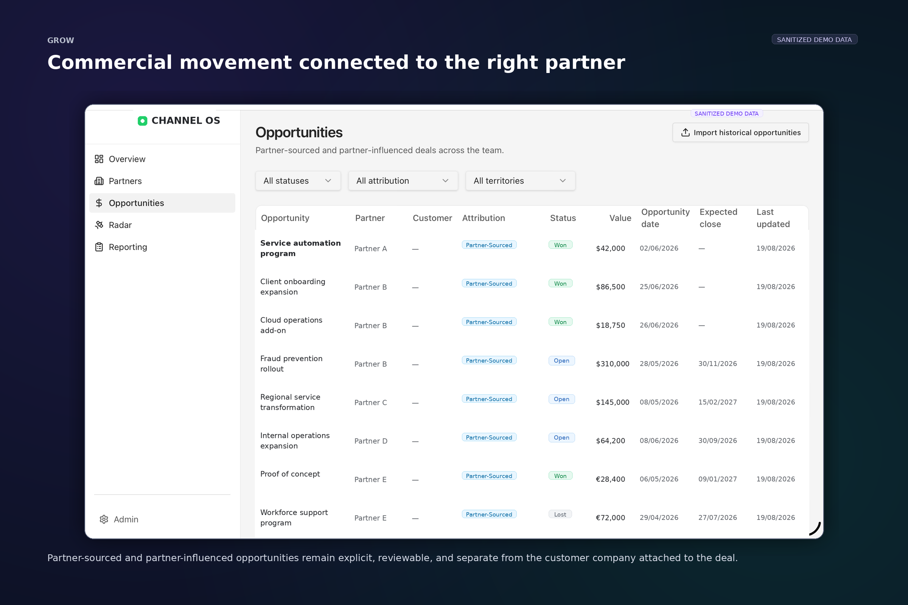
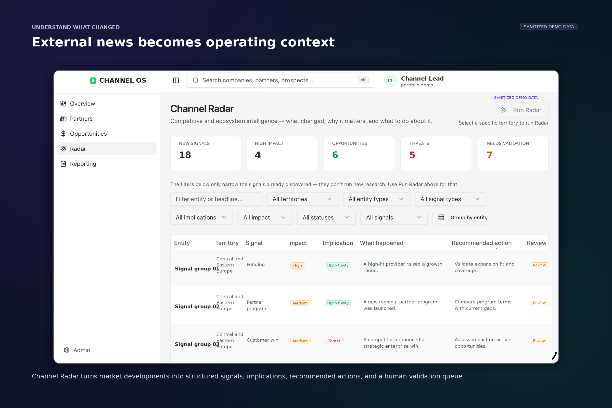
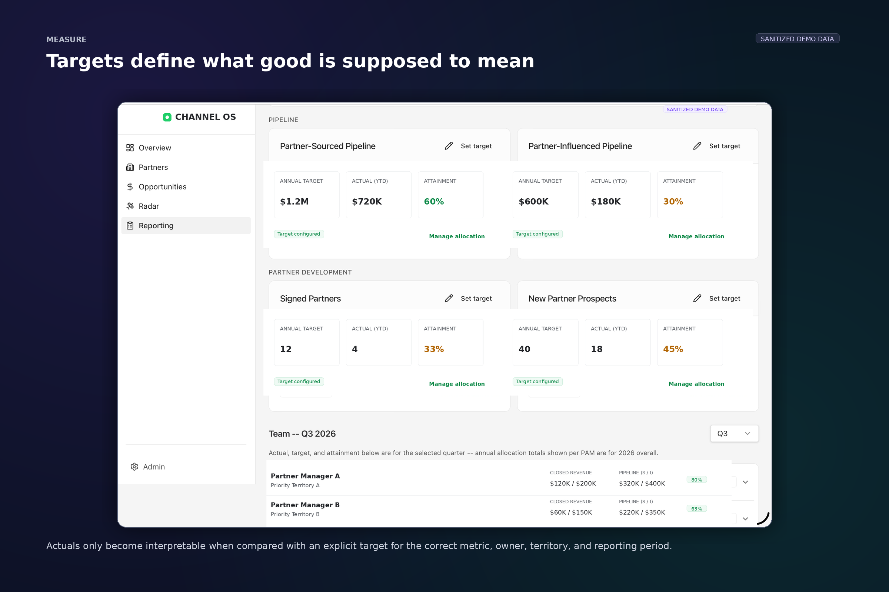
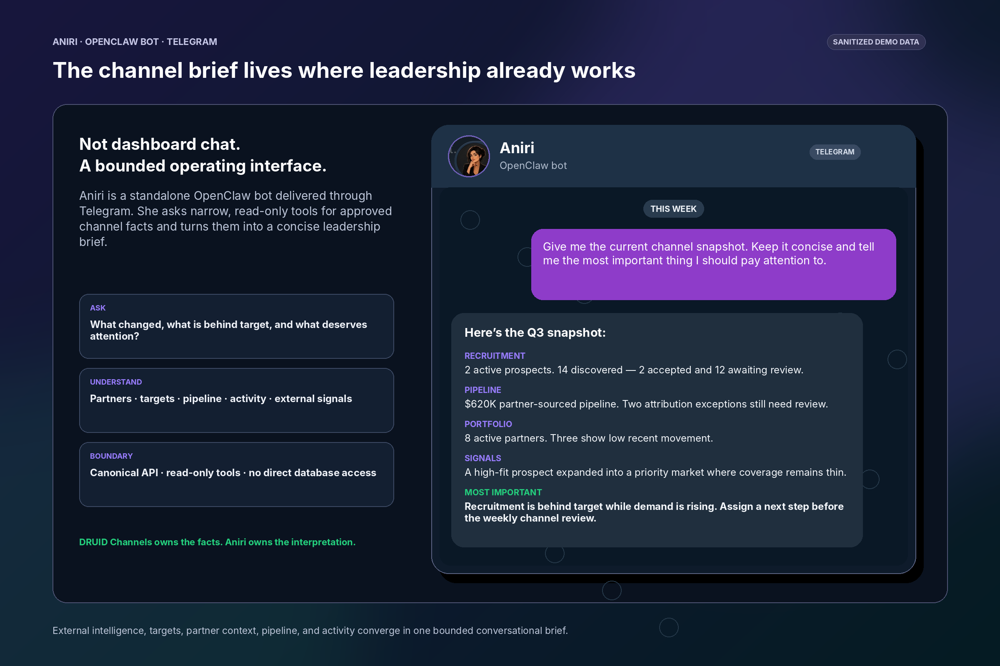
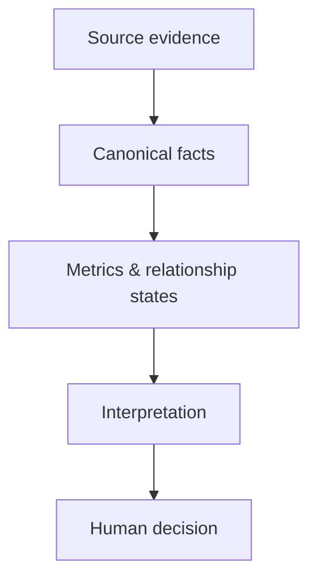
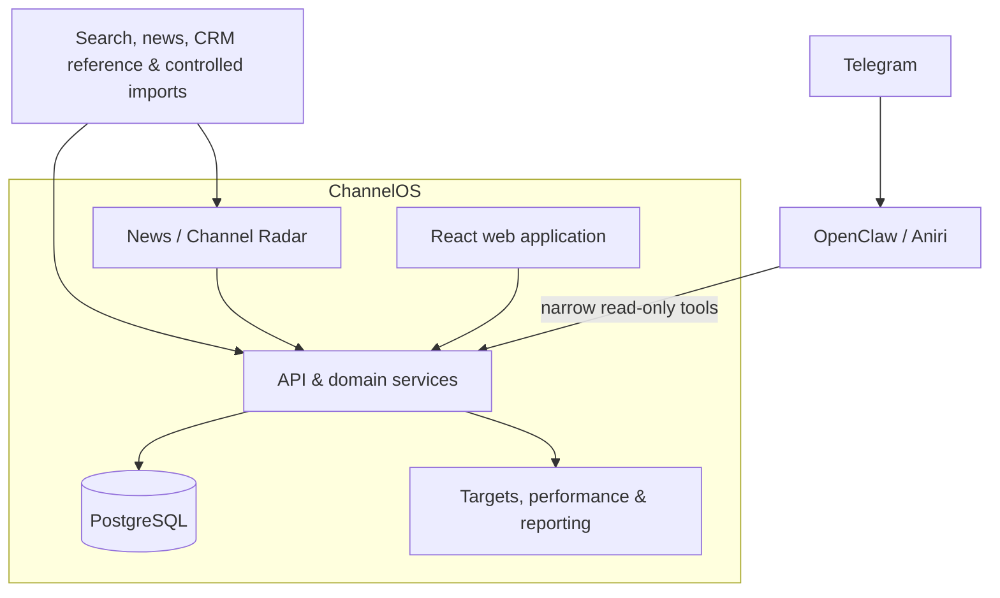

  <picture>
    <source media="(prefers-color-scheme: dark)" srcset="./assets/readme/hero-dark.svg">
    
  </picture>

# ChannelOS

### **An AI-native operating system for a partner organization**

**Discover → Recruit → Activate → Grow → Measure → Decide**

*Built for DRUID’s partner organization. Presented publicly as ChannelOS.*

---

## Why I built it

I started with a smaller project called **Partner Radar**.

The idea was simple: instead of waiting for good partner candidates to appear in a spreadsheet or someone’s inbox, could I build a system that found interesting companies and explained why they might be worth a closer look?

It worked well enough to expose the real problem.

Finding a company is only the beginning. The next questions are harder: **Do we already know them? Is there a real relationship? Who owns it? What changed recently? Is there partner-attributed pipeline? Are we on target? Which news actually matters, and which is just another press release?**

**ChannelOS is what grew around those questions.**

It brings discovery, recruitment, partner context, opportunities, news and market intelligence, targets, PAM execution, performance, and reporting into the same product.

---

## How the pieces fit together

The point is not to squeeze everything into one dashboard. Each part has a job, but they all work from the same commercial picture.

| Area | The question it answers |
|---|---|
| **Discovery** | Who might be worth pursuing? |
| **Recruitment** | Are we actually trying to build a relationship? |
| **Portfolio** | Who are we working with, who owns it, and where does the relationship stand? |
| **Opportunities** | What commercial movement is genuinely connected to the partner? |
| **News & Channel Radar** | What changed outside the company, and does it alter our view? |
| **Targets & Performance** | What did we expect, and how are we doing against it? |
| **PAM Workspace** | What does each partner manager need to move next? |
| **Reporting** | What does leadership need to understand without rebuilding the story by hand? |
| **Aniri** | What does all of this mean when several signals are viewed together? |

---

## The product in six views

### 1. Find companies worth a second look

Discovery is the part of the original Partner Radar idea that still sits at the front of ChannelOS.

It does not treat every company returned by a search as a future partner. It gives someone enough evidence to decide whether the company is interesting, irrelevant, already known, or worth assigning to a PAM.

  

  <strong>Discovery creates a candidate, not a relationship.</strong>

---

### 2. Know where the relationship actually stands

“Company exists” and “we have a partner relationship” are not the same state, even though a lot of systems quietly behave as if they are.

ChannelOS keeps the journey visible: a company can be discovered, reviewed, assigned, recruited, activated, stalled, rejected, or managed as an active relationship. Ownership and history stay attached as that state changes.

That sounds like basic hygiene. It is also what stops discovery counts, partner counts, and relationship reporting from becoming the same number with three labels.

---

### 3. Connect commercial outcomes without lying about attribution

Opportunity data is useful, but it is also where a polished dashboard can become confidently wrong.

A deal may include the customer, a partner, several contacts, old associations, and an opportunity name that happens to resemble a company. ChannelOS keeps **partner**, **customer**, **attribution type**, **value**, **status**, and **timing** separate and reviewable.

  

  <strong>A plausible pipeline number is not enough. The relationship behind it has to be believable too.</strong>

---

### 4. Treat news as context, not wallpaper

The news part became much more important than I expected.

Partner data ages quickly. A company that looked mildly interesting three months ago can announce an expansion, launch a complementary product, hire a new leader, acquire another business, or enter a market where the channel has weak coverage. Suddenly the context changes.

Channel Radar keeps track of those external developments and ties them back to prospects, partners, territories, and existing assumptions. The useful question is not **“What happened today?”** It is:

> **Did anything happen that should change how we think about this company or market?**

  

Not every article deserves attention. A recent article is not automatically a signal, and a signal is not automatically an action. The system can surface, review, dismiss, and preserve the developments that actually add context.

---

### 5. Set expectations before judging performance

A number without a target is just a number.

€500K in pipeline might be excellent, disappointing, or completely irrelevant depending on the PAM, territory, metric, quarter, and target it is being compared with. ChannelOS keeps those expectations explicit and then shows actual progress against the right scope.

  

  <strong>No target configured is not the same thing as 0% achieved.</strong>

Targets are not only for a management dashboard. They give PAM reviews, weekly reporting, performance tracking, and Aniri a shared definition of what “on track” is supposed to mean.

---

### 6. Give leadership a different way into the same system

Aniri is part of ChannelOS, but she is not ChannelOS.

She is a standalone **OpenClaw bot** used through **Telegram**. Her job is to read approved facts through narrow tools and help leadership make sense of several things at once: partner context, recent news, targets, pipeline, activity, and missing information.

  

Aniri does not get direct database access and she does not get to invent new business logic because an answer would sound better that way.

> **ChannelOS owns the facts. Aniri helps interpret them. Humans decide what happens next.**

---

## The bit I care about most

The part of ChannelOS I am most opinionated about is not the AI.

It is whether the product can admit that something is missing, ambiguous, or simply not known yet.

- A blank target is **not** a zero target.
- A company mentioned on a deal is **not automatically** the partner.
- A company in Discovery is **not already** a managed relationship.
- A fresh article is **not automatically** an important signal.
- A persuasive AI summary is **not** a business fact.

A lot of software becomes easier to demo when every gap is filled in. It becomes much harder to trust.

ChannelOS takes the less glamorous route: unresolved things can remain unresolved, ambiguous attribution can go to review, and unavailable metrics can remain unavailable until the product has enough evidence to say more.

---

## Before and after

| Before | With ChannelOS |
|---|---|
| Research lives in tabs, documents, CRM fields, and people’s memory. | Context accumulates around the company and relationship. |
| Discovery creates another list to maintain. | A useful company can enter recruitment and ownership workflows. |
| News is read and forgotten. | Relevant developments become persistent company and territory context. |
| Pipeline attribution can look right while being wrong. | Ambiguity becomes visible review work. |
| Performance is discussed as a raw number. | Actuals are compared with explicit targets, owners, periods, and scopes. |
| Leadership rebuilds the story every week. | The web app, reporting, and Aniri draw from the same underlying model. |

---

## Architecture

The application and Aniri feel different to the user, but they eventually meet the same domain services.

That is deliberate:

- **one shared commercial model**
- **different interfaces for different jobs**
- **role and territory scope enforced below the UI**
- **AI used for interpretation, not for inventing identity, targets, or attribution**

---

## Why this is in my portfolio

I work in product marketing, and ChannelOS was my way of making myself earn stronger opinions about how products like this should actually work.

The useful part was not just learning how to build the frontend or wire an AI agent into a tool. It was having to live with the consequences of the product decisions.

It is easy to draw a box called **Partner** on a slide. It is harder when the system has to decide whether a company is only interesting, is being recruited, is already managed, appears on a deal as the customer, or is genuinely the partner connected to the opportunity.

The same thing happened with News. “Add market intelligence” sounds good until the product has to distinguish an important change from a press release that happens to contain the right keywords.

And “add an AI Chief of Staff” sounds good until the agent asks for a metric that does not exist or tries to turn an unknown into a confident answer.

That is why this project belongs here. It forced **product strategy, UX, data modeling, AI boundaries, commercial logic, and positioning** to become one problem instead of six separate disciplines.

> **I am not especially interested in being a marketer who can code as a party trick. I am interested in technical products where understanding the system makes the story better.**

---

## Go deeper

<strong>Why the truth model matters</strong>

 

Most internal products look cleaner when incomplete data is quietly coerced into a usable shape.

ChannelOS does the opposite. Missing targets remain unavailable. Ambiguous opportunity attribution can remain under review. A company can exist without being turned into an active partner. The product is allowed to show that the business does not currently know something.

<strong>How News becomes a signal</strong>

 

Channel Radar treats external information as a candidate input, not as automatic truth.

A development can be connected to a company, prospect, partner, or territory, given an impact and implication, reviewed by a human, and either preserved as useful context or dismissed as noise.

The purpose is not to build another news feed. It is to keep the commercial picture from going stale.

<strong>Why Aniri is separate from the web application</strong>

 

The web app is where operators review, correct, assign, configure, and work.

Aniri is where leadership can ask for a concise interpretation of approved facts.

Keeping the bot separate makes the tool and authority boundary clearer. She calls narrow read-only tools through OpenClaw instead of behaving like a magical chat box with direct access to everything.

<strong>What this project demonstrates</strong>

 

- product strategy that survives implementation;
- turning a narrow discovery idea into a broader operating model;
- treating News and external change as persistent commercial context;
- target setting and performance tracking across owners and periods;
- opportunity attribution that prefers review over fake certainty;
- role-aware product design for channel leadership and PAMs;
- AI behind explicit tools and authority boundaries.

---

## Related projects

- **AI Agent Sudo** — a small, provider-neutral authorization layer for AI agents.
- **VoiceWire** — a local diagnostic engine for voice AI systems that combines packet evidence with agent traces.
- **Mission Control** — an account-centric GTM signal and operating system for DRUID.

---

  <strong>Mihail Lupu</strong> 
  Product marketer. Occasionally I get curious enough to build the thing I am trying to explain.

