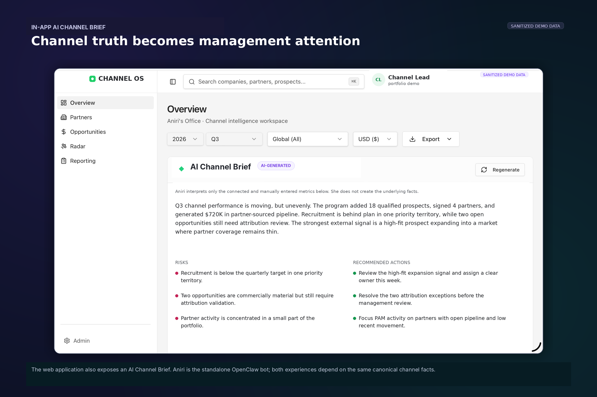
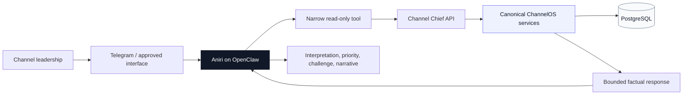
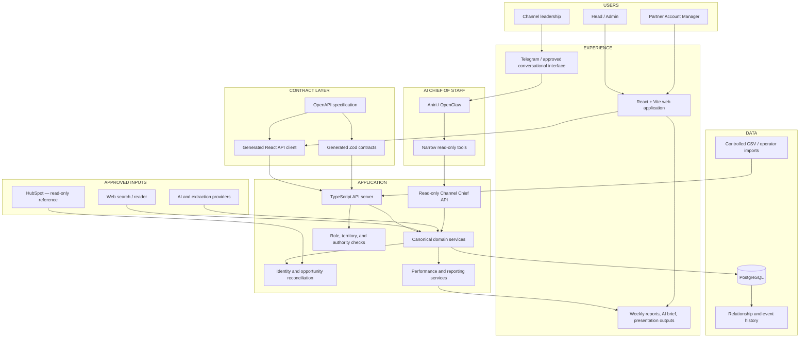
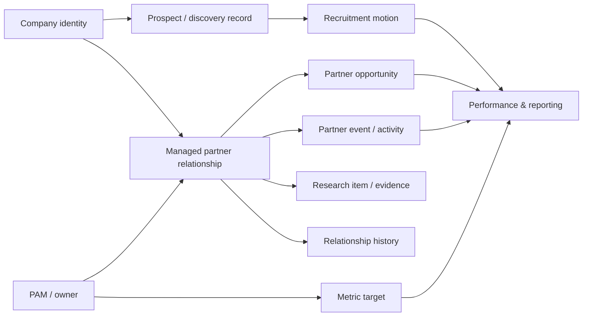

<!--
  ChannelOS — public-safe portfolio README
  Built for Mihail Lupu.

  IMPORTANT:
  - The hero images referenced below are included in /assets/readme/.
  - The included screenshots use synthetic, sanitized demo data.
  - Keep credentials, customer/partner records, production hostnames, and private endpoints out of a public repository.
-->

<picture>
  <source media="(prefers-color-scheme: dark)" srcset="./assets/readme/hero-dark.svg">
  <source media="(prefers-color-scheme: light)" srcset="./assets/readme/hero-light.svg">
  
</picture>

<div align="center">

### **An AI-native operating system for a partner organization.**

*Built for DRUID’s partner organization. Publicly presented as ChannelOS.*

</div>

I started this as **Partner Radar**, mostly because I wanted a better answer to a simple question: *which companies should a channel team actually care about?*

That question turned out to be the easy part. The moment a useful company appeared, the harder questions started: Is it already known? Is there a real relationship? Who owns it? What changed? Is the pipeline actually attributable to the partner? Are we on target? Is that news item relevant or just noise? What does leadership need to know this week?

**ChannelOS is what grew around those questions.**

It brings discovery, partner context, opportunities, targets, market intelligence, PAM execution, reporting, and an AI Chief of Staff into the same operating model — without pretending that every missing field is a zero or every AI-generated sentence is a fact.

---

## 01 — The idea

Channel work looks fairly tidy from far away. Up close, it is usually spread across a CRM, spreadsheets, research tabs, pipeline reports, target sheets, email, and whatever people still remember from the last partner call.

None of those systems is necessarily wrong. The problem is that each one knows only a piece of the story.

A company might look interesting in research but already be sitting untouched in the CRM. A deal might mention both a customer and a partner, but not make the relationship between them obvious. A PAM might be “behind” only because the wrong reporting period is being compared. A news item might be genuinely important, or it might simply be recent.

Partner Radar started as an experiment in the first part of that problem: discovering companies and explaining why they might be relevant. Once I had useful results, I realized discovery by itself was not especially useful. A list of promising companies is still a list.

So the project expanded until the system could answer a much more practical set of questions:

- **Who is this company to us?**
- **Are we trying to recruit them, already working with them, or neither?**
- **Who owns the relationship?**
- **What happened recently?**
- **Which opportunities are really connected to the partner?**
- **What was the team supposed to achieve, and how is it actually doing?**
- **What changed outside the company that could alter our priorities?**
- **What is missing or uncertain?**
- **And what, if anything, is worth doing next?**

That is the core of ChannelOS: not another place to store partner data, but a way to keep the commercial story around a partner coherent as it changes.

> **One company can have many signals, activities, opportunities, people, and decisions. The useful part is keeping them connected without turning guesses into facts.**

---

## 02 — Before and after

The easiest way to explain ChannelOS is to compare it with the way this work usually happens.

| | **Before** | **With ChannelOS** |
|---|---|---|
| **Partner discovery** | Companies arrive through ad hoc searches, introductions, spreadsheets, and memory. | Discovery becomes a reviewable workflow with evidence, status, ownership, and assignment. |
| **Partner identity** | The same company can exist under multiple names, domains, or systems. | A canonical company record becomes the anchor for research, relationships, activity, and opportunities. |
| **Relationship state** | “Partner” can mean prospect, recruited, active, inactive, or simply mentioned in a deal. | The company and the managed partner relationship are separate concepts with explicit state. |
| **Opportunity attribution** | A customer company associated with a deal can accidentally be mistaken for the partner. | Partner identity follows safe reconciliation rules and never silently falls back to the deal’s customer company. |
| **Missing data** | Blank dates, values, or targets become zeros, guesses, or invisible reporting errors. | Missing information remains unavailable or moves into a visible **Needs Review** state. |
| **PAM workflow** | The Head of Channels and a PAM often work from the same undifferentiated interface. | Each role gets a different operating surface, authority boundary, and data scope. |
| **Research** | Evidence is copied into notes or lost after the decision. | Sources, research items, and changes remain attached to the relevant company and relationship. |
| **Reporting** | Weekly and management reporting is manually assembled from several systems. | The same canonical services feed dashboards, weekly views, AI briefs, and presentation outputs. |
| **AI** | A model receives a broad prompt and produces plausible management prose. | AI receives bounded, read-only facts from canonical services and is explicitly prevented from becoming the source of truth. |
| **Leadership attention** | Everything appears equally important until somebody manually interprets it. | The system separates signal, status, performance, risk, and recommended attention. |

<br>

<table>
  <tr>
    <td width="33%" valign="top">
      <strong>◎ Less searching</strong><br><br>
      A partner conversation should not begin with twenty minutes of reopening tabs and trying to remember which source was current.
    </td>
    <td width="33%" valign="top">
      <strong>◇ Less guessing</strong><br><br>
      If the system does not know something, it should say so. A clean-looking answer is not better than an honest gap.
    </td>
    <td width="33%" valign="top">
      <strong>↗ Better decisions</strong><br><br>
      The point is not to create another pile of metrics. It is to make the next decision easier to understand.
    </td>
  </tr>
</table>

---

## 03 — The product

The cleanest way to understand ChannelOS is as a **loop**, not a collection of pages. A company can enter through discovery, become a recruitment motion, turn into a managed relationship, create commercial activity, and eventually be judged against targets and outcomes.

<p align="center">
  
</p>

<p align="center"><sub><strong>Discovery becomes an operating workflow.</strong> Evidence, priority, territory, ownership, status, and “why now” remain visible instead of disappearing into a spreadsheet.</sub></p>


```text
A company is discovered
        ↓
Evidence is collected
        ↓
A human reviews the prospect
        ↓
Ownership is assigned
        ↓
Recruitment is tracked
        ↓
A managed partner relationship is created
        ↓
Activities and opportunities accumulate
        ↓
Targets and performance become measurable
        ↓
Leadership receives a truthful operating view
        ↓
Aniri helps decide what deserves attention
```

### The six movements of the system

<table>
  <tr>
    <td width="16%" align="center"><strong>01</strong><br><br>◎<br><br><strong>Discover</strong></td>
    <td width="16%" align="center"><strong>02</strong><br><br>◇<br><br><strong>Recruit</strong></td>
    <td width="16%" align="center"><strong>03</strong><br><br>◆<br><br><strong>Activate</strong></td>
    <td width="16%" align="center"><strong>04</strong><br><br>↗<br><br><strong>Grow</strong></td>
    <td width="16%" align="center"><strong>05</strong><br><br>▦<br><br><strong>Measure</strong></td>
    <td width="16%" align="center"><strong>06</strong><br><br>◉<br><br><strong>Decide</strong></td>
  </tr>
  <tr>
    <td valign="top">Find credible companies and capture why they may be relevant.</td>
    <td valign="top">Track the process of turning a prospect into a real relationship.</td>
    <td valign="top">Create a managed portfolio relationship with explicit ownership and state.</td>
    <td valign="top">Connect opportunities, activities, research, and commercial movement.</td>
    <td valign="top">Compare real outcomes with targets across the right period and scope.</td>
    <td valign="top">Surface what matters, what is missing, and where human attention belongs.</td>
  </tr>
</table>

<!--
SCREENSHOT SLOT — PRODUCT OVERVIEW

Upload a sanitized screenshot to:
  assets/readme/product-overview.png

Then uncomment:

<p align="center">
  
</p>
-->

---

## 04 — Product surfaces

The same data does not imply the same job. A Head of Channels is trying to understand the whole business; a PAM is trying to move a specific set of partners and prospects forward. ChannelOS gives them different views of the same underlying truth.

| **Surface** | **What it is for** | **Head / Admin experience** | **PAM experience** |
|---|---|---|---|
| **Overview** | The commercial state of the channel business. | Team-level performance, attention, AI Channel Brief, management reporting, and cross-territory context. | Personal or role-scoped performance and the work that belongs to the current PAM. |
| **Discovery / My Prospects** | New partner identification and qualification. | Run and manage discovery, review the global pool, assign ownership, and decide what enters execution. | See only explicitly assigned prospects; no global scan controls or unassigned pool. |
| **Recruitment** | The journey from credible prospect to recruited partner. | Review recruitment movement across territories and owners. | Maintain and progress the relationships in the PAM’s scope. |
| **Portfolio** | The managed partner relationship. | View the full portfolio, ownership, relationship status, history, and items needing attention. | Work with the PAM’s own partner relationships and account context. |
| **Opportunities** | Partner-sourced and partner-influenced commercial outcomes. | Review the pipeline across partners, PAMs, territories, currencies, and periods. | Maintain and inspect opportunities inside the PAM’s authorized scope. |
| **Channel Radar** | Persisted market and territory intelligence. | Configure, run, review, and dismiss intelligence signals. | Read the intelligence relevant to the PAM’s territory without global run or review authority. |
| **My Workspace** | A practical execution surface. | Primarily oversight rather than day-to-day ownership. | A focused operating view for the PAM’s assigned work. |
| **Marketing Activities** | Partner-facing and market-facing activity. | Inspect activity coverage and reporting. | Record and maintain the activities that create context around the relationship. |
| **Team Targets** | The measurable expectations for channel execution. | Define or inspect team-level targets and reporting periods. | Consume the relevant target context; no global target administration. |
| **PAMs** | Team and individual management context. | Compare ownership, portfolio, pipeline, recruitment, activity, and performance. | Not a global team-management surface. |
| **Weekly Reporting** | A consistent operational cadence. | Team-level weekly view and drill-down. | Personal weekly report and progress against the relevant period. |
| **Connections & Settings** | Provider configuration and operating controls. | Configure approved search, extraction, AI, and integration behavior. | Restricted to the settings appropriate for the PAM role. |

### The two jobs are deliberately different

The Head of Channels needs to answer:

- Where is the portfolio strong or weak?
- Which PAM or territory needs attention?
- Is the pipeline real?
- Where are recruitment efforts stalled?
- Are we measuring the same thing across the team?
- Which signals are worth acting on?

A PAM needs to answer:

- Which prospects are actually mine?
- Which partner should I focus on next?
- What has changed in my territory?
- Which relationship is incomplete?
- Which opportunity or activity needs updating?
- What will I report this week?

Giving both roles the same dashboard would have been simpler. It also would have pushed the real work back onto the user.

---


<!--
REAL PRODUCT VISUAL 02 — PARTNER DETAIL

When you have a sanitized screenshot, save it as:
  assets/readme/partner-detail.png

Then remove the surrounding HTML comment.

<p align="center">
  
</p>

<p align="center">
  <sub><strong>The company becomes the anchor.</strong> Research, relationship state, people, activity, opportunities, evidence, and the next decision converge around one canonical commercial context.</sub>
</p>
-->

<p align="center">
  
</p>

<p align="center"><sub><strong>Commercial movement stays attributable.</strong> The partner, customer, attribution type, status, value, and timing remain separate and reviewable.</sub></p>

## 05 — A practical example

Suppose Channel Radar or Discovery finds a company that looks genuinely relevant.

### Step 1 — Discovery

The company enters the discovery workflow with the source that found it, the evidence available at the time, and an initial assessment. Nothing more is assumed. It is a prospect, not magically a partner because an AI model liked the website.

```text
DISCOVERED COMPANY
status: prospective
relationship: none
owner: unassigned
evidence: available
confidence: bounded
```

### Step 2 — Review and assignment

Someone with global responsibility reviews the prospect. If it is worth pursuing, it can be assigned to a PAM and move from interesting research into actual execution.

```text
GLOBAL DISCOVERY POOL
        ↓ human review
ASSIGNED PROSPECT
        ↓ PAM execution
RECRUITMENT MOTION
```

The PAM sees the work that was assigned to them; they do not suddenly inherit the controls for running or reviewing the global discovery pool.

### Step 3 — Recruitment

Recruitment has its own state because “we found them” and “we have a relationship” are not the same thing. A prospect can progress, stall, be rejected, or simply remain unresolved, and each of those tells the team something different.

### Step 4 — Portfolio relationship

A company record and a managed partner relationship are not the same thing.

```text
company
   └── partner relationship
          ├── owner / PAM
          ├── status
          ├── territory
          ├── relationship history
          ├── research
          ├── activities
          └── opportunities
```

That separation prevents a shortcut that looks harmless until reporting starts:

> “There is an opportunity connected to this company, therefore it must already be an active partner.”

ChannelOS does not make that leap automatically.

### Step 5 — Commercial movement

Once the relationship is real, opportunities and activity can be connected to it without losing the distinction between partner, customer, source, influence, and outcome. That is when research, pipeline, targets, and history start to become useful together.

### Step 6 — Leadership attention

At that point leadership can ask something more useful than “what is in the database?”:

> **What changed, why does it matter, and who should look at it?**

---

## News becomes signal

News is not useful just because it is new. Channel Radar exists because partner context goes stale: a funding round, market expansion, product launch, acquisition, leadership change, or new partnership can suddenly make an old prospect more interesting — or less.

<p align="center">
  
</p>

| **A normal news feed** | **Channel Radar** |
|---|---|
| Shows articles. | Connects a development to an entity, territory, signal type, and implication. |
| Treats reading as the outcome. | Routes important signals into validation and possible action. |
| Every story competes for attention. | Impact, implication, evidence, and existing relationship context determine importance. |
| Disappears down a timeline. | Persists relevant intelligence as part of the operating context. |

## Targets define what “good” means

A number without an expectation is just a number. €500K in pipeline can be excellent or terrible depending on the target, territory, PAM, period, and metric being discussed. Targets give the rest of the product something concrete to measure against.

<p align="center">
  
</p>

| **Without explicit targets** | **With ChannelOS** |
|---|---|
| “Pipeline looks healthy.” | Actual pipeline is compared with an explicit annual or quarterly expectation. |
| Activity and performance blur together. | Prospect creation, partner signing, pipeline, revenue, and activity remain distinct metrics. |
| Different owners and periods get mixed. | Attainment is calculated for the correct PAM, territory, scope, and reporting period. |
| A missing target can look like failure. | **Not configured** remains different from **0% attained**. |
| Leadership reconstructs the context manually. | Aniri can explain variance using the same canonical target and actual data. |

---

## 06 — The truth model

The part of ChannelOS I care about most is not the AI and it is not the dashboard. It is whether the system can admit when it does not know something.

### A fact, an interpretation, and a decision are not the same thing

| **Layer** | **Question** | **Example** | **Owner** |
|---|---|---|---|
| **Source fact** | What did an approved source actually provide? | A company domain, opportunity value, activity date, or target. | Source system / operator input |
| **Canonical fact** | How does the application represent that information consistently? | A normalized company, relationship, opportunity, event, or reporting period. | ChannelOS domain services |
| **Derived metric** | What follows deterministically from the canonical facts? | Pipeline total, target progress, recruitment count, or activity coverage. | ChannelOS business rules |
| **Interpretation** | What may deserve attention? | A stalled relationship, a slow-moving deal, or a territory with weak coverage. | Aniri or UI presentation |
| **Human decision** | What should actually happen? | Review, contact, correct, wait, escalate, or do nothing. | Authorized user |

### Things ChannelOS deliberately refuses to fake

| **Situation** | **Truthful behavior** | **Shortcut deliberately rejected** |
|---|---|---|
| A target is missing. | Show the metric as unavailable or not configured. | Treat missing target as zero and calculate misleading attainment. |
| A commercial value is missing. | Move the record into **Needs Review**. | Invent or silently infer a value. |
| The partner company cannot be resolved exactly. | Keep the identity unresolved and ask for correction. | Choose the most plausible company using fuzzy similarity. |
| A deal has a primary customer company. | Treat it as the customer unless an approved partner match exists. | Reuse the customer company as the partner. |
| A company has an opportunity but no managed relationship. | Create or flag a neutral relationship state for review when the identity is exact. | Automatically mark the company as an active partner. |
| The AI lacks a metric. | Say that the metric is unavailable. | Produce a management-sounding estimate. |
| Two people share a similar name. | Return bounded ambiguity or not found. | Select whichever person looks closest. |
| Nothing meaningful changed. | Stay quiet or show no material change. | Manufacture urgency because the interface needs content. |

> [!IMPORTANT]
> **Unknown is not the same thing as no.**
>  
> A missing relationship date does not mean the relationship started today.  
> A missing target does not mean the target is zero.  
> A missing metric does not mean performance is poor.  
> A missing source does not become evidence simply because an LLM can write a sentence about it.

---

## 07 — Safe opportunity reconciliation

Opportunity data is where a system like this can become dangerously convincing. A deal may include a customer, a partner, multiple contacts, renamed companies, old associations, and half-complete fields. It is very easy to produce a pipeline chart that looks polished and is quietly attributing revenue to the wrong company.

So the reconciliation rules are intentionally conservative. If ChannelOS cannot make a deterministic match, it stops pretending.

| **Input condition** | **Accepted behavior** | **Why** |
|---|---|---|
| Exact company-domain match | Reuse the canonical company. | The identifier is stable enough to support deterministic matching. |
| Exact normalized deal-name match | Reconcile to the known deal where appropriate. | It is inspectable and repeatable. |
| Duplicate company-domain match | Stop and require review. | Ambiguity should be resolved, not hidden. |
| Deal primary company only | Do not treat it as the partner. | The primary company is commonly the customer or end client. |
| Missing opportunity date | Keep the row in **Needs Review**. | Historical reporting depends on the real event date. |
| Missing or invalid deal value | Keep the row in **Needs Review**. | Commercial reporting should not be built on fictional numbers. |
| Existing relationship | Reuse it without silently changing its status. | Imports should not rewrite managed relationship truth. |
| Missing relationship with exact company identity | Create or flag a neutral review relationship, depending on the approved workflow. | The commercial connection is real, but its managed state still requires ownership. |
| Repeated import | Remain idempotent and detect duplicates. | Operational workflows must be safe to rerun. |

<details>
<summary><strong>Why “Needs Review” is a product feature, not an error state</strong></summary>

<br>

A lot of internal tools hide data quality problems because a green success screen feels nicer than a queue of unresolved records. I would rather make the problem visible.

A record that cannot be trusted should remain visible, specific, and actionable:

```text
what is missing
        ↓
why the system cannot proceed
        ↓
what a human must correct
        ↓
how the row can be safely reprocessed
```

That turns data quality into visible work instead of an invisible administrative mess somebody discovers three reports later.

</details>

---

## 08 — Aniri as an intelligent interface

Aniri only became worth building after the rest of ChannelOS existed. Before that, she would have been a chatbot sitting on top of incomplete context and producing very confident summaries.

The more interesting question was:

> **If the underlying facts are trustworthy, can an AI behave more like a sharp channel Chief of Staff than a query box?**


<p align="center">
  
</p>

That became **Aniri**.

There are two AI experiences in the project. The web app has an **AI Channel Brief**. **Aniri is the actual bot**: a standalone Telegram experience running through OpenClaw.

I think of Aniri as the leadership interface, not as a feature hidden inside a dashboard. Telegram is simply where the conversation happens today; OpenClaw hosts the bot and the narrow tools she is allowed to call. She does not get a database connection, a general shell, or permission to improvise new business logic because the prompt sounds plausible.

Her job is fairly simple to describe:

- **know the context she is allowed to know;**
- **notice when several facts together tell a more interesting story;**
- **explain that story in normal language;**
- **challenge weak conclusions instead of polishing them;**
- and **say nothing important happened when nothing important happened.**

That last one matters more than it sounds. A Chief of Staff who manufactures urgency every morning is just another notification system.

### The boundary



### Who owns what

| **Concern** | **ChannelOS** | **Aniri** |
|---|---|---|
| Canonical business facts | **Owns** | Consumes |
| Metric definitions | **Owns** | Does not redefine |
| Role and territory scope | **Owns** | Must respect |
| Source reconciliation | **Owns** | Does not guess |
| Missing-data semantics | **Owns** | Must preserve |
| Prioritization language | Provides structured inputs | **Owns** |
| Commercial interpretation | Provides facts and context | **Owns** |
| Challenge and recommendation | Provides evidence | **Owns** |
| Database access | Internal application responsibility | **None** |
| Source-system writes | Controlled application workflows only | **None** |
| General shell / crawler access | Not part of the contract | **None** |

### Why I did not want “chat with your dashboard”

| **Generic dashboard chat** | **Aniri** |
|---|---|
| Reads a broad data dump. | Calls narrow, approved tools. |
| Recalculates metrics inside the prompt. | Receives metrics from the canonical application service. |
| Produces polished prose even when evidence is weak. | Distinguishes known, suspected, unavailable, and worth checking. |
| Waits for ritualized prompts. | Is designed to notice material changes and eventually work proactively. |
| Speaks like a management report. | Speaks like a smart, commercially sharp colleague. |
| Treats every question as a reason to produce content. | Can conclude that something is probably noise. |

> **The critical rule:** ChannelOS owns the facts. Aniri owns the interpretation. Humans own consequential decisions.

That boundary is what lets the AI be useful without quietly becoming the place where business truth gets invented.

---

## 09 — Architecture

Under the UI, ChannelOS is a TypeScript monorepo with a React application, API server, PostgreSQL model, generated contracts, and a handful of deliberately narrow integration boundaries. The web app and Aniri look very different to the user, but they eventually meet the same domain services.



### Architecture principles

| **Principle** | **Implementation consequence** |
|---|---|
| **One source of commercial truth** | UI, reports, exports, and Aniri consume the same canonical services instead of rebuilding business logic independently. |
| **Contract first** | The OpenAPI specification drives generated client types and validation contracts. |
| **Role separation is not cosmetic** | Authority is enforced at the API and reflected in the UI; hiding a button is not treated as authorization. |
| **External systems are inputs, not owners** | HubSpot can help reconcile known facts, but it does not silently replace DRUID’s partner model. |
| **AI sits after truth, not before it** | Models interpret structured facts; they do not define core metrics or identity. |
| **Operational changes are rerunnable** | Imports and backfills are designed around preview, dry-run, idempotency, and explicit apply steps. |
| **History is part of the model** | Relationship changes and events are preserved because “what changed?” is a first-class question. |

---

## 10 — Canonical domain model

The company is the anchor, but I deliberately avoided making the company row carry every meaning in the system. A company can exist long before it becomes a prospect, partner, opportunity source, or managed relationship.



### Core entities

| **Entity** | **Purpose** | **Why it exists separately** |
|---|---|---|
| **Company** | Canonical organization identity. | A company can exist before, during, or after a managed partner relationship. |
| **Prospect** | A discovered company under review. | Discovery status and evidence should not prematurely alter the portfolio. |
| **Recruitment** | The motion of creating a partnership. | Recruitment progress is commercially meaningful even before activation. |
| **Partner relationship** | The managed commercial relationship with owner, state, and history. | “This company exists” and “we actively manage this partner” are different facts. |
| **Opportunity** | A partner-sourced or partner-influenced commercial outcome. | Pipeline and revenue need attribution, status, currency, period, and provenance. |
| **Partner event / activity** | The observable work around the relationship. | Activity provides operating context and supports reporting over time. |
| **Research item** | Evidence gathered about the company or relationship. | Conclusions need inspectable sources and history. |
| **Relationship history** | Changes to the managed relationship. | Current state alone cannot explain what changed or when. |
| **Metric target** | The expected outcome for a user, team, territory, or period. | Performance is meaningless without the correct target and scope. |
| **PAM / user** | Ownership and execution context. | Access, responsibility, reporting, and territory scope depend on the actor. |

---

## 11 — Engineering decisions

Most of the interesting engineering work came from shortcuts that looked perfectly reasonable in a demo and became wrong as soon as the product had to be trusted.

| **Decision** | **Tempting shortcut** | **Why the chosen approach matters** |
|---|---|---|
| Separate company from partner relationship. | Put `is_partner = true` on the company row. | The relationship has ownership, status, history, source, and review semantics that do not belong to company identity. |
| Separate global Discovery from My Prospects. | Reuse one page and hide a few controls. | PAMs and global operators have different authority and different jobs to perform. |
| Keep role scope on the server. | Filter global results in the browser. | Data the user should not access should never be returned merely because the UI promises not to display it. |
| Use exact reconciliation rules. | Fuzzy-match names and hope for the best. | Commercial attribution must be deterministic and explainable. |
| Preserve missing data. | Convert blank values into defaults. | A neat dashboard built on false certainty is worse than an honest incomplete one. |
| Reuse one performance engine. | Recalculate metrics separately for UI, reports, and AI. | Multiple metric implementations drift and eventually contradict each other. |
| Generate clients from OpenAPI. | Hand-maintain frontend request and response types. | Contract drift becomes visible during code generation and type checking. |
| Keep Aniri outside the database boundary. | Give the agent SQL or broad API access. | Narrow read-only tools create a controllable authority surface. |
| Use dry-run backfills. | Execute migration scripts directly in production. | Operational data changes need inspectable counts and an explicit apply step. |
| Make imports idempotent. | Assume every file is uploaded once. | Real operators retry, correct, and re-upload data. The system must be safe under repetition. |
| Preserve history. | Store only the latest state. | Leadership questions are often about movement, not just current values. |
| Treat “no action” as valid. | Always generate a recommendation. | Not every signal deserves work, and noise is a real operational cost. |

---

## 12 — Integrations and authority boundaries

I did not want every connected system to become another source of truth. Each integration has a narrow job and an explicit authority boundary.

| **System / capability** | **Role in ChannelOS** | **Authority** |
|---|---|---|
| **PostgreSQL** | Canonical application state. | Read/write through the application and controlled scripts. |
| **Web search** | Discovery and research input. | Read-only external input; results require application interpretation. |
| **Web reader / extraction** | Converts approved source pages into structured evidence. | Read-only external input. |
| **AI provider** | Classification, synthesis, or narrative where explicitly designed. | No ownership of canonical identity or business rules. |
| **HubSpot** | Reconciliation and reference for companies and opportunities. | Read-only; no silent partner substitution and no uncontrolled writes. |
| **CSV / operator import** | Controlled business input for portfolio and opportunities. | Previewed, validated, and routed through canonical application rules. |
| **OpenClaw / Aniri** | Hosts the standalone Telegram bot and its approved leadership-interpretation tools. | Narrow, read-only tools; no direct database or general shell access. |
| **PPTX / reports** | Leadership-ready output generated from canonical reporting services. | Output only; does not create a second data model. |

---

## 13 — Repository anatomy

> [!NOTE]
> **Naming:** `ChannelOS` is the public portfolio name. The underlying project/codebase was built for DRUID’s partner organization and may still contain internal `druid-channels` naming in repository paths, deployment configuration, or historical references.


> [!NOTE]
> **Public-repository boundary.**
> This README is written as a public-safe product and engineering case study. It intentionally excludes customer records, partner records, credentials, production hostnames, and sensitive internal endpoints. Screenshots in this README use synthetic, fully sanitized demo data; real people, company names, logos, domains, and confidential commercial values have been removed or replaced.


```text
druid-channels/
│
├── artifacts/
│   ├── api-server/             # TypeScript API, routes, domain services, scripts, tests
│   └── partner-radar/          # React/Vite application and product experience
│
├── lib/
│   ├── api-spec/               # Canonical OpenAPI contract
│   ├── api-client-react/       # Generated React Query client
│   ├── api-zod/                # Generated runtime validation contracts
│   └── db/                     # PostgreSQL schema and database package
│
├── docs/                       # Architecture, contracts, runbooks, and handover material
├── docker-compose.yml          # Containerized application topology
├── DEPLOYMENT.md               # Deployment workflow and operational notes
├── PROJECT_HANDOFF.md          # Current-state and continuation context
└── package.json                # Workspace scripts
```

### Why the repository is shaped this way

| **Area** | **Responsibility** |
|---|---|
| `artifacts/partner-radar` | Presentation and operator interaction. It should explain the system without becoming the source of business truth. |
| `artifacts/api-server` | Authorization, orchestration, domain services, import workflows, reporting, and integration boundaries. |
| `lib/db` | The canonical relational model shared by the application. |
| `lib/api-spec` | The contract that connects server, generated clients, and validation. |
| `lib/api-client-react` | Typed API consumption in the web application. |
| `lib/api-zod` | Runtime contract validation rather than TypeScript-only optimism. |
| `docs` | The decisions, boundaries, and operating procedures that code alone cannot communicate. |

---

## 14 — Validation and testing

The tests are mostly organized around ways the product could lie or overreach, not just whether a component renders.

| **Risk area** | **What the tests protect** | **Representative coverage** |
|---|---|---|
| **Role separation** | Global users and PAMs receive the correct routes, data scope, and authority. | `roleSeparation.test.ts`, route and navigation regressions |
| **Partner reconciliation** | Opportunities do not create or mutate relationships incorrectly. | `partnerRelationshipService.test.ts`, `portfolioOpportunityReconciliation.test.ts` |
| **PAM resolution** | A name resolves only when it is unique and safe. | `pamResolution.test.ts`, PAM overview route coverage |
| **Commercial metrics** | Currency, period selection, and commercial cascade remain consistent. | `commercialCurrencyDisplay.test.ts`, `commercialCascade.test.ts` |
| **Targets** | The correct target is selected for the correct actor and reporting period. | `metricTargetSelection.test.ts` |
| **Channel Radar** | Run authority and persisted intelligence behavior remain role-correct. | `channelRadarRun.test.ts` |
| **Discovery workflow** | Scan progress, assignment, and prospect state remain coherent. | `discoveryProgress.test.ts` |
| **Reporting navigation** | Weekly team and individual reporting remain reachable and correctly scoped. | `reportingNavigation.test.ts` |
| **Connections** | Configured, unavailable, and unsupported integrations are represented truthfully. | `connectionDisplay.test.ts` |
| **Generated contracts** | Schema, API specification, clients, and runtime types stay aligned. | DB generation, API code generation, and full-workspace type checking |

### Useful verification commands

```bash
pnpm install

# Regenerate database artifacts when schema definitions change.
pnpm --filter @workspace/db run generate

# Regenerate API clients and runtime contracts when OpenAPI changes.
pnpm --filter @workspace/api-spec run codegen

# Verify the complete TypeScript workspace.
pnpm run typecheck

# Build and run the containerized topology.
docker compose up --build
```

> [!CAUTION]
> Never point tests, local experiments, or backfill scripts at the production database.  
> Production backfills should be dry-run first, inspected, and applied only through an explicit approved step.

---

## 15 — Product design

I wanted the interface to feel calm even when the underlying work is messy. This is operational software: sometimes a dense table is more useful than a beautiful card, and sometimes the right visualization is no visualization at all.

### Design principles

| **Principle** | **What it means in the product** |
|---|---|
| **Hierarchy before decoration** | The most important decision or exception appears before secondary detail. |
| **Dense when work is dense** | Tables are used for comparison, review, and repeated operations where cards would waste space. |
| **Progressive disclosure** | The operator sees the useful summary first and can open evidence, history, or detail when needed. |
| **Visible provenance** | Source domains and evidence remain inspectable instead of disappearing inside AI prose. |
| **Restrained color** | Color communicates status and exception rather than merely making the interface look active. |
| **No fake motion** | A loading shimmer is not progress. Workflow state must reflect real backend state. |
| **No dashboard theatre** | Charts are included when they compress useful information, not because a management page is expected to contain charts. |
| **Role-specific language** | A Head of Channels sees management context; a PAM sees executable work. |
| **Unknown remains visible** | The UI distinguishes unavailable, not configured, unresolved, empty, and zero. |

### Visual direction

```text
Microsoft / Fluent calm
        +
Apple-like hierarchy
        +
operator-grade information density
        +
visible evidence
        -
gratuitous dashboard chrome
```

<!--
SCREENSHOT SLOTS

Upload sanitized files:
  assets/readme/overview.png
  assets/readme/discovery.png
  assets/readme/portfolio.png
  assets/readme/aniri.png

Then uncomment this block:

<table>
  <tr>
    <td width="50%">
      
    </td>
    <td width="50%">
      
    </td>
  </tr>
  <tr>
    <td width="50%">
      
    </td>
    <td width="50%">
      
    </td>
  </tr>
</table>
-->

---

## 16 — Why this is in my portfolio

I work in product marketing, which means I spend a lot of time explaining why products exist, how they should be positioned, and why anyone should care.

ChannelOS was my way of making myself earn those opinions.

I built it inside **DRUID’s partner organization**, around problems that were actually annoying: partner discovery, ownership, opportunity attribution, targets, market intelligence, reporting, and the simple difficulty of answering “what is really going on?” without opening six systems.

The code was useful, but the more valuable part was being forced to live with the consequences of product decisions. It is easy to draw a box called **Partner** on a slide. It is harder when the database has to decide whether a company merely exists, is being recruited, is already managed, appears in a deal as the customer, or is genuinely the partner that influenced the opportunity.

The same thing happened with AI. “Add a Chief of Staff” sounds great until the agent asks for a metric that does not exist, two people have the same name, the target was never configured, or a missing value would make the summary more convenient if you simply treated it as zero.

Those are the parts of the project I like most, because they are where positioning, UX, data modelling, architecture, and commercial judgment stop being separate disciplines.

### What the project demonstrates

| **Discipline** | **What I did** |
|---|---|
| **Product strategy** | Defined the product thesis, the operating model, the user roles, and the difference between a radar, a CRM, a dashboard, and a channel operating system. |
| **Problem framing** | Turned “find partners with AI” into a more useful problem: create a trustworthy system from discovery through commercial outcome. |
| **Information architecture** | Designed separate surfaces for Discovery, Recruitment, Portfolio, Opportunities, Radar, Activities, Targets, Reporting, and role-specific work. |
| **UX and product design** | Built a calm enterprise workspace with explicit states, visible evidence, progressive disclosure, and role-aware interaction. |
| **Domain modelling** | Separated company identity, prospects, recruitment, managed relationships, opportunities, events, research, history, targets, and users. |
| **Full-stack engineering** | Built and evolved the React frontend, TypeScript API, PostgreSQL model, OpenAPI contract, generated clients, validation, tests, and Docker deployment. |
| **AI product design** | Placed AI behind a narrow factual boundary instead of allowing the model to own metrics, identity, or authority. |
| **Data quality** | Designed exact matching, Needs Review, idempotent imports, explicit unknowns, and safe backfill behavior. |
| **Commercial systems thinking** | Connected partner activity, pipeline, recruitment, targets, performance, and management reporting into one operating picture. |
| **Operational discipline** | Maintained runbooks, handovers, deployment checks, dry-run conventions, and production-safety boundaries. |

### The portfolio point

I am not especially interested in being “a marketer who can code” as a party trick.

I am interested in technical products where the positioning falls apart if the architecture is dishonest — and where understanding the architecture makes the positioning much better.

That is what ChannelOS became for me:

> **a product story I could only tell properly after I had wrestled with the system underneath it.**

---

## 17 — What ChannelOS is not

| **It is not** | **Because** |
|---|---|
| A replacement CRM | CRM remains useful for customer and deal operations; ChannelOS focuses on the partner operating model around it. |
| A generic company scraper | Discovery is only valuable when it connects to ownership, evidence, relationship state, and action. |
| A BI dashboard | The product includes operational workflows, corrections, assignments, imports, and decisions—not just reporting. |
| An autonomous outbound agent | Partner strategy and external action remain human-controlled. |
| “Chat with your data” | Aniri has a bounded role and consumes approved facts through narrow read-only tools. |
| A fuzzy matching engine | Identity and attribution are too commercially sensitive for plausible guessing. |
| A second performance model | UI, reports, and AI should use the same canonical definitions. |
| A demo built around perfect data | Needs Review, unavailable metrics, ambiguous identity, and operational correction are first-class product states. |

---

## 18 — Project evolution

| **Stage** | **Question** | **What changed** |
|---|---|---|
| **Partner Radar** | Can the system discover relevant companies and explain the fit? | Research, signals, evidence, and initial opportunity framing. |
| **Operational discovery** | Who reviews, assigns, and acts on those companies? | Global Discovery and PAM-specific My Prospects. |
| **Relationship system** | What happens after a prospect becomes real? | Recruitment, managed portfolio relationships, ownership, and history. |
| **Commercial system** | How does the relationship connect to outcomes? | Opportunities, attribution, activity, targets, currency, and periods. |
| **Management system** | How does leadership see the whole picture? | Overview, weekly reporting, team views, AI briefs, and presentation output. |
| **Chief-of-Staff layer** | Can AI help leadership focus without becoming the source of truth? | Aniri, OpenClaw, narrow tools, read-only Channel Chief APIs, and explicit authority boundaries. |

You will still see **Partner Radar** in the repository because that is where the project began. I kept it rather than pretending the product appeared fully formed.

---

## 19 — Documentation

| **Document** | **Purpose** |
|---|---|
| [`DEPLOYMENT.md`](./DEPLOYMENT.md) | Container, environment, and deployment workflow. |
| [`PROJECT_HANDOFF.md`](./PROJECT_HANDOFF.md) | Current architecture, state, constraints, and continuation context. |
| [`docs/`](./docs) | Domain contracts, API boundaries, feature-specific architecture, and operational notes. |
| [`docker-compose.yml`](./docker-compose.yml) | Application topology for the API and web services. |
| [`lib/api-spec/openapi.yaml`](./lib/api-spec/openapi.yaml) | Canonical HTTP contract. |

---

## 20 — Related projects

ChannelOS sits next to a few other projects where I keep coming back to the same theme: AI is much more interesting once the boundaries around it are explicit.

### [AI Agent Sudo](https://github.com/MLupu88/ai-agent-sudo)

A small, provider-neutral authorization checkpoint for AI agent and MCP tool calls.

```text
agent wants to act
        ↓
deterministic policy
        ↓
allow / deny / require approval
```

### [VoiceWire](https://github.com/MLupu88/voicewire)

A diagnostic engine for voice AI systems that combines packet and media evidence with agent evidence to localize latency and failure boundaries.

### GTM Mission Control

An account-centric operating system built around signals, evidence, account understanding, prioritization, and human-supervised action.

---

<div align="center">

## Built by Mihail Lupu

**Product marketer. Occasionally I get curious enough to build the thing I am trying to explain.**

[GitHub](https://github.com/MLupu88) ·
[LinkedIn](https://www.linkedin.com/in/mihail-lupu/)

<br>

<sub>
Built to learn. Documented because the interesting part is not only what the product does, but why it ended up this way.
</sub>

</div>
