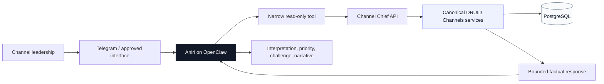
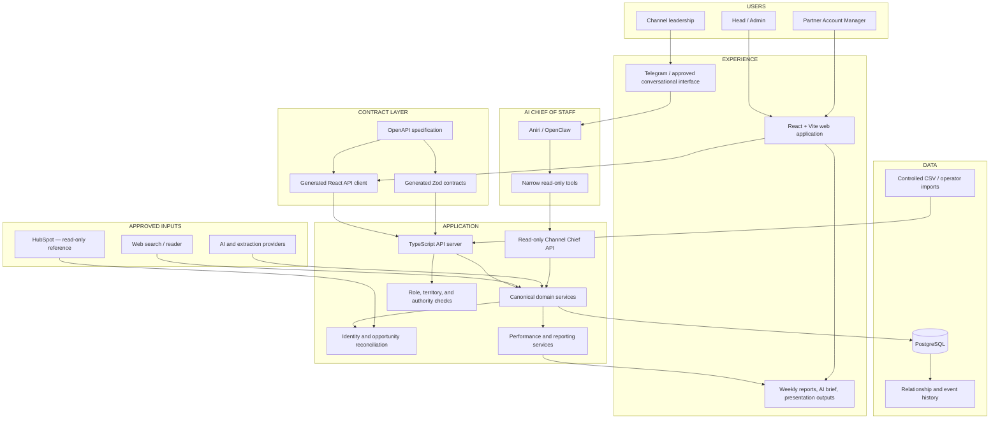
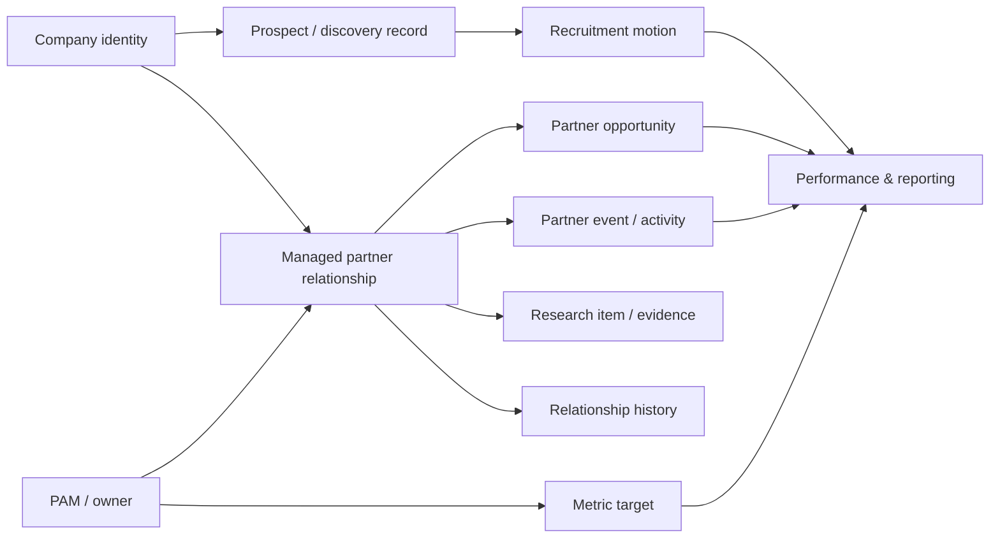

<!--
  DRUID Channels — public-safe portfolio README
  Built for Mihail Lupu.

  IMPORTANT:
  - The hero images referenced below are included in /assets/readme/.
  - Screenshot blocks are commented out until real screenshots are uploaded.
  - Keep credentials, customer/partner records, production hostnames, and private endpoints out of a public repository.
-->

<picture>
  <source media="(prefers-color-scheme: dark)" srcset="./assets/readme/hero-dark.svg">
  <source media="(prefers-color-scheme: light)" srcset="./assets/readme/hero-light.svg">
  
</picture>

<div align="center">

# DRUID Channels

### **Partner intelligence, channel operations, and an AI Chief of Staff — in one coherent system.**

A full-stack operating system for discovering partners, managing the commercial relationship, connecting opportunities to the right company, measuring channel performance, and helping leadership decide what deserves attention.

<br>

<kbd>DISCOVER</kbd>
&nbsp;→&nbsp;
<kbd>RECRUIT</kbd>
&nbsp;→&nbsp;
<kbd>ACTIVATE</kbd>
&nbsp;→&nbsp;
<kbd>GROW</kbd>
&nbsp;→&nbsp;
<kbd>MEASURE</kbd>
&nbsp;→&nbsp;
<kbd>DECIDE</kbd>

<br><br>

[The idea](#01--the-idea) ·
[Before and after](#02--before-and-after) ·
[Product](#03--the-product) ·
[Truth model](#06--the-truth-model) ·
[Aniri](#08--aniri-the-ai-chief-of-staff) ·
[Architecture](#09--architecture) ·
[Engineering](#11--engineering-decisions) ·
[Portfolio story](#16--why-this-is-in-my-portfolio)

</div>

---

> [!NOTE]
> **This README is written as a public-safe product and engineering case study.**
> It intentionally excludes customer records, partner records, credentials, production hostnames, and sensitive internal endpoints. Screenshots should use synthetic or fully sanitized data.

---

## 01 — The idea

Partner programs rarely suffer from a complete absence of data.

They suffer from data that lives in the wrong shape.

A company appears in a spreadsheet. A contact sits in the CRM. Opportunity attribution is buried in a deal record. Research lives in browser tabs. Partner activity arrives through presentations, messages, and memory. Targets are somewhere else again. Then, once a week or once a quarter, somebody attempts to reconstruct the state of the channel business by hand.

That reconstruction is slow, inconsistent, and usually too late.

**DRUID Channels started as a much smaller experiment: Partner Radar.**

The original question was simple:

> Could a system continuously discover relevant companies and explain why they might matter as partners?

The difficult part appeared immediately after the first useful result.

Finding a company was not enough.

The system also needed to know:

- whether that company already existed;
- whether it was a prospect, a recruited partner, or an active relationship;
- who owned it;
- which territory it belonged to;
- what evidence supported the assessment;
- whether an opportunity was partner-sourced or partner-influenced;
- what changed since the last review;
- what was known, inferred, missing, or contradictory;
- and what a human should do next.

So Partner Radar grew into **DRUID Channels**: a channel operating system built around one canonical commercial picture.

> **One company. One relationship context. Every relevant motion around it.**

---

## 02 — Before and after

The product is easiest to understand by looking at the operating model it replaces.

| | **Before** | **With DRUID Channels** |
|---|---|---|
| **Partner discovery** | Companies arrive through ad hoc searches, introductions, spreadsheets, and memory. | Discovery becomes a reviewable workflow with evidence, status, ownership, and assignment. |
| **Partner identity** | The same company can exist under multiple names, domains, or systems. | A canonical company record becomes the anchor for research, relationships, activity, and opportunities. |
| **Relationship state** | “Partner” can mean prospect, recruited, active, inactive, or simply mentioned in a deal. | The company and the managed partner relationship are separate concepts with explicit state. |
| **Opportunity attribution** | A customer company associated with a deal can accidentally be mistaken for the partner. | Partner identity follows safe reconciliation rules and never silently falls back to the deal’s customer company. |
| **Missing data** | Blank dates, values, or targets become zeros, guesses, or invisible reporting errors. | Missing information remains unavailable or moves into a visible **Needs Review** state. |
| **PAM workflow** | The Head of Channels and a PAM often work from the same undifferentiated interface. | Each role gets a different operating surface, authority boundary, and data scope. |
| **Research** | Evidence is copied into notes or lost after the decision. | Sources, research items, and changes remain attached to the relevant company and relationship. |
| **Reporting** | Weekly and management reporting is manually assembled from several systems. | The same canonical services feed dashboards, weekly views, AI briefs, and presentation outputs. |
| **AI** | A model receives a broad prompt and produces plausible management prose. | AI receives bounded, read-only facts from canonical services and is explicitly prevented from becoming the source of truth. |
| **Leadership attention** | Everything appears equally important until somebody manually interprets it. | The system separates signal, status, performance, risk, and recommended attention. |

<br>

<table>
  <tr>
    <td width="33%" valign="top">
      <strong>◎ Less searching</strong><br><br>
      The operator should not have to reconstruct the state of a partner from six browser tabs before every conversation.
    </td>
    <td width="33%" valign="top">
      <strong>◇ Less guessing</strong><br><br>
      Unknown is allowed to remain unknown. The product does not improve by becoming confidently wrong.
    </td>
    <td width="33%" valign="top">
      <strong>↗ Better decisions</strong><br><br>
      The final output is not “more data.” It is a clearer view of what matters and what should happen next.
    </td>
  </tr>
</table>

---

## 03 — The product

DRUID Channels is not one dashboard.

It is a connected set of workflows that follow the lifecycle of a partner relationship.

```text
A company is discovered
        ↓
Evidence is collected
        ↓
A human reviews the prospect
        ↓
Ownership is assigned
        ↓
Recruitment is tracked
        ↓
A managed partner relationship is created
        ↓
Activities and opportunities accumulate
        ↓
Targets and performance become measurable
        ↓
Leadership receives a truthful operating view
        ↓
Aniri helps decide what deserves attention
```

### The six movements

<table>
  <tr>
    <td width="16%" align="center"><strong>01</strong><br><br>◎<br><br><strong>Discover</strong></td>
    <td width="16%" align="center"><strong>02</strong><br><br>◇<br><br><strong>Recruit</strong></td>
    <td width="16%" align="center"><strong>03</strong><br><br>◆<br><br><strong>Activate</strong></td>
    <td width="16%" align="center"><strong>04</strong><br><br>↗<br><br><strong>Grow</strong></td>
    <td width="16%" align="center"><strong>05</strong><br><br>▦<br><br><strong>Measure</strong></td>
    <td width="16%" align="center"><strong>06</strong><br><br>◉<br><br><strong>Decide</strong></td>
  </tr>
  <tr>
    <td valign="top">Find credible companies and capture why they may be relevant.</td>
    <td valign="top">Track the process of turning a prospect into a real relationship.</td>
    <td valign="top">Create a managed portfolio relationship with explicit ownership and state.</td>
    <td valign="top">Connect opportunities, activities, research, and commercial movement.</td>
    <td valign="top">Compare real outcomes with targets across the right period and scope.</td>
    <td valign="top">Surface what matters, what is missing, and where human attention belongs.</td>
  </tr>
</table>

<!--
SCREENSHOT SLOT — PRODUCT OVERVIEW

Upload a sanitized screenshot to:
  assets/readme/product-overview.png

Then uncomment:

<p align="center">
  
</p>
-->

---

## 04 — Product surfaces

The interface is role-aware. It does not assume that channel leadership and a Partner Account Manager should see the same controls merely because they use the same data.

| **Surface** | **What it is for** | **Head / Admin experience** | **PAM experience** |
|---|---|---|---|
| **Overview** | The commercial state of the channel business. | Team-level performance, attention, AI Channel Brief, management reporting, and cross-territory context. | Personal or role-scoped performance and the work that belongs to the current PAM. |
| **Discovery / My Prospects** | New partner identification and qualification. | Run and manage discovery, review the global pool, assign ownership, and decide what enters execution. | See only explicitly assigned prospects; no global scan controls or unassigned pool. |
| **Recruitment** | The journey from credible prospect to recruited partner. | Review recruitment movement across territories and owners. | Maintain and progress the relationships in the PAM’s scope. |
| **Portfolio** | The managed partner relationship. | View the full portfolio, ownership, relationship status, history, and items needing attention. | Work with the PAM’s own partner relationships and account context. |
| **Opportunities** | Partner-sourced and partner-influenced commercial outcomes. | Review the pipeline across partners, PAMs, territories, currencies, and periods. | Maintain and inspect opportunities inside the PAM’s authorized scope. |
| **Channel Radar** | Persisted market and territory intelligence. | Configure, run, review, and dismiss intelligence signals. | Read the intelligence relevant to the PAM’s territory without global run or review authority. |
| **My Workspace** | A practical execution surface. | Primarily oversight rather than day-to-day ownership. | A focused operating view for the PAM’s assigned work. |
| **Marketing Activities** | Partner-facing and market-facing activity. | Inspect activity coverage and reporting. | Record and maintain the activities that create context around the relationship. |
| **Team Targets** | The measurable expectations for channel execution. | Define or inspect team-level targets and reporting periods. | Consume the relevant target context; no global target administration. |
| **PAMs** | Team and individual management context. | Compare ownership, portfolio, pipeline, recruitment, activity, and performance. | Not a global team-management surface. |
| **Weekly Reporting** | A consistent operational cadence. | Team-level weekly view and drill-down. | Personal weekly report and progress against the relevant period. |
| **Connections & Settings** | Provider configuration and operating controls. | Configure approved search, extraction, AI, and integration behavior. | Restricted to the settings appropriate for the PAM role. |

### The product is intentionally asymmetric

The Head of Channels needs to answer:

- Where is the portfolio strong or weak?
- Which PAM or territory needs attention?
- Is the pipeline real?
- Where are recruitment efforts stalled?
- Are we measuring the same thing across the team?
- Which signals are worth acting on?

A PAM needs to answer:

- Which prospects are actually mine?
- Which partner should I focus on next?
- What has changed in my territory?
- Which relationship is incomplete?
- Which opportunity or activity needs updating?
- What will I report this week?

A product that gives both users the same dashboard is easier to build.

It is also less useful.

---

## 05 — A practical example

Imagine the system discovers a potentially relevant company.

### Step 1 — Discovery

The company enters the discovery workflow with a source, evidence, and an initial relevance assessment.

At this stage, the system does **not** pretend that the company is already a partner.

```text
DISCOVERED COMPANY
status: prospective
relationship: none
owner: unassigned
evidence: available
confidence: bounded
```

### Step 2 — Review and assignment

A Head/Admin reviews the company and decides whether it is credible enough to enter execution.

If it is, the prospect can be assigned to a PAM.

```text
GLOBAL DISCOVERY POOL
        ↓ human review
ASSIGNED PROSPECT
        ↓ PAM execution
RECRUITMENT MOTION
```

The PAM sees the assigned record.

The PAM does not gain global discovery authority.

### Step 3 — Recruitment

Recruitment is tracked as its own commercial motion rather than being hidden in notes.

The relationship may progress, stall, be rejected, or remain uncertain.

Each of those is a meaningful state.

### Step 4 — Portfolio relationship

A company record and a managed partner relationship are not the same thing.

```text
company
   └── partner relationship
          ├── owner / PAM
          ├── status
          ├── territory
          ├── relationship history
          ├── research
          ├── activities
          └── opportunities
```

That separation prevents a common shortcut:

> “There is an opportunity connected to this company, therefore it must already be an active partner.”

DRUID Channels does not make that leap automatically.

### Step 5 — Commercial movement

Partner-sourced or partner-influenced opportunities become part of the commercial picture.

Activities, research, relationship history, pipeline, targets, and performance can now be viewed together.

### Step 6 — Leadership attention

The system can now answer a more useful question than “What data do we have?”

It can answer:

> **What changed, why does it matter, and who should look at it?**

---

## 06 — The truth model

The most important product decision is not the dashboard layout.

It is the system’s relationship with uncertainty.

### Facts, interpretations, and decisions are different things

| **Layer** | **Question** | **Example** | **Owner** |
|---|---|---|---|
| **Source fact** | What did an approved source actually provide? | A company domain, opportunity value, activity date, or target. | Source system / operator input |
| **Canonical fact** | How does the application represent that information consistently? | A normalized company, relationship, opportunity, event, or reporting period. | DRUID Channels domain services |
| **Derived metric** | What follows deterministically from the canonical facts? | Pipeline total, target progress, recruitment count, or activity coverage. | DRUID Channels business rules |
| **Interpretation** | What may deserve attention? | A stalled relationship, a slow-moving deal, or a territory with weak coverage. | Aniri or UI presentation |
| **Human decision** | What should actually happen? | Review, contact, correct, wait, escalate, or do nothing. | Authorized user |

### What the product refuses to fake

| **Situation** | **Truthful behavior** | **Shortcut deliberately rejected** |
|---|---|---|
| A target is missing. | Show the metric as unavailable or not configured. | Treat missing target as zero and calculate misleading attainment. |
| A commercial value is missing. | Move the record into **Needs Review**. | Invent or silently infer a value. |
| The partner company cannot be resolved exactly. | Keep the identity unresolved and ask for correction. | Choose the most plausible company using fuzzy similarity. |
| A deal has a primary customer company. | Treat it as the customer unless an approved partner match exists. | Reuse the customer company as the partner. |
| A company has an opportunity but no managed relationship. | Create or flag a neutral relationship state for review when the identity is exact. | Automatically mark the company as an active partner. |
| The AI lacks a metric. | Say that the metric is unavailable. | Produce a management-sounding estimate. |
| Two people share a similar name. | Return bounded ambiguity or not found. | Select whichever person looks closest. |
| Nothing meaningful changed. | Stay quiet or show no material change. | Manufacture urgency because the interface needs content. |

> [!IMPORTANT]
> **Unknown is not the same thing as no.**
>  
> A missing relationship date does not mean the relationship started today.  
> A missing target does not mean the target is zero.  
> A missing metric does not mean performance is poor.  
> A missing source does not become evidence simply because an LLM can write a sentence about it.

---

## 07 — Safe opportunity reconciliation

Opportunity data is commercially useful and structurally dangerous.

A deal usually contains multiple companies, contacts, owners, labels, and historical edits. A naïve import can connect revenue to the wrong partner while still looking perfectly plausible in a dashboard.

DRUID Channels uses a deliberately conservative reconciliation model.

| **Input condition** | **Accepted behavior** | **Why** |
|---|---|---|
| Exact company-domain match | Reuse the canonical company. | The identifier is stable enough to support deterministic matching. |
| Exact normalized deal-name match | Reconcile to the known deal where appropriate. | It is inspectable and repeatable. |
| Duplicate company-domain match | Stop and require review. | Ambiguity should be resolved, not hidden. |
| Deal primary company only | Do not treat it as the partner. | The primary company is commonly the customer or end client. |
| Missing opportunity date | Keep the row in **Needs Review**. | Historical reporting depends on the real event date. |
| Missing or invalid deal value | Keep the row in **Needs Review**. | Commercial reporting should not be built on fictional numbers. |
| Existing relationship | Reuse it without silently changing its status. | Imports should not rewrite managed relationship truth. |
| Missing relationship with exact company identity | Create or flag a neutral review relationship, depending on the approved workflow. | The commercial connection is real, but its managed state still requires ownership. |
| Repeated import | Remain idempotent and detect duplicates. | Operational workflows must be safe to rerun. |

<details>
<summary><strong>Why “Needs Review” is a product feature, not an error state</strong></summary>

<br>

Many internal tools optimize for a clean-looking success screen.

That often means coercing incomplete data into a shape the system can accept.

DRUID Channels takes the opposite position.

A record that cannot be trusted should remain visible, specific, and actionable:

```text
what is missing
        ↓
why the system cannot proceed
        ↓
what a human must correct
        ↓
how the row can be safely reprocessed
```

This makes the data-quality workflow part of the product instead of an invisible administrative problem.

</details>

---

## 08 — Aniri, the AI Chief of Staff

The system eventually produced a second question:

> Once the facts are trustworthy, could an AI help leadership decide what deserves attention?

That became **Aniri**.

Aniri is a standalone AI Chief of Staff for channel leadership. She is deliberately **not** embedded as a general-purpose chatbot with direct access to the database.

Her job is to:

- observe approved business facts;
- assess what is meaningful;
- prioritize risks, opportunities, contradictions, and stalled work;
- explain the reasoning in plain language;
- recommend the next useful question or action;
- challenge weak conclusions;
- and remain quiet when there is nothing important to add.

### The boundary



### Who owns what

| **Concern** | **DRUID Channels** | **Aniri** |
|---|---|---|
| Canonical business facts | **Owns** | Consumes |
| Metric definitions | **Owns** | Does not redefine |
| Role and territory scope | **Owns** | Must respect |
| Source reconciliation | **Owns** | Does not guess |
| Missing-data semantics | **Owns** | Must preserve |
| Prioritization language | Provides structured inputs | **Owns** |
| Commercial interpretation | Provides facts and context | **Owns** |
| Challenge and recommendation | Provides evidence | **Owns** |
| Database access | Internal application responsibility | **None** |
| Source-system writes | Controlled application workflows only | **None** |
| General shell / crawler access | Not part of the contract | **None** |

### What makes Aniri different from “chat with your dashboard”

| **Generic dashboard chat** | **Aniri** |
|---|---|
| Reads a broad data dump. | Calls narrow, approved tools. |
| Recalculates metrics inside the prompt. | Receives metrics from the canonical application service. |
| Produces polished prose even when evidence is weak. | Distinguishes known, suspected, unavailable, and worth checking. |
| Waits for ritualized prompts. | Is designed to notice material changes and eventually work proactively. |
| Speaks like a management report. | Speaks like a smart, commercially sharp colleague. |
| Treats every question as a reason to produce content. | Can conclude that something is probably noise. |

> **The critical rule:** DRUID Channels owns the facts. Aniri owns the interpretation.

That boundary is the difference between adding AI to an operating system and allowing a model to become an operating system.

---

## 09 — Architecture

DRUID Channels is a TypeScript monorepo with a browser application, API server, canonical data model, generated clients, and controlled integration boundaries.



### Architecture principles

| **Principle** | **Implementation consequence** |
|---|---|
| **One source of commercial truth** | UI, reports, exports, and Aniri consume the same canonical services instead of rebuilding business logic independently. |
| **Contract first** | The OpenAPI specification drives generated client types and validation contracts. |
| **Role separation is not cosmetic** | Authority is enforced at the API and reflected in the UI; hiding a button is not treated as authorization. |
| **External systems are inputs, not owners** | HubSpot can help reconcile known facts, but it does not silently replace DRUID’s partner model. |
| **AI sits after truth, not before it** | Models interpret structured facts; they do not define core metrics or identity. |
| **Operational changes are rerunnable** | Imports and backfills are designed around preview, dry-run, idempotency, and explicit apply steps. |
| **History is part of the model** | Relationship changes and events are preserved because “what changed?” is a first-class question. |

---

## 10 — Canonical domain model

The company is the anchor, but it is not the entire story.



### Core entities

| **Entity** | **Purpose** | **Why it exists separately** |
|---|---|---|
| **Company** | Canonical organization identity. | A company can exist before, during, or after a managed partner relationship. |
| **Prospect** | A discovered company under review. | Discovery status and evidence should not prematurely alter the portfolio. |
| **Recruitment** | The motion of creating a partnership. | Recruitment progress is commercially meaningful even before activation. |
| **Partner relationship** | The managed commercial relationship with owner, state, and history. | “This company exists” and “we actively manage this partner” are different facts. |
| **Opportunity** | A partner-sourced or partner-influenced commercial outcome. | Pipeline and revenue need attribution, status, currency, period, and provenance. |
| **Partner event / activity** | The observable work around the relationship. | Activity provides operating context and supports reporting over time. |
| **Research item** | Evidence gathered about the company or relationship. | Conclusions need inspectable sources and history. |
| **Relationship history** | Changes to the managed relationship. | Current state alone cannot explain what changed or when. |
| **Metric target** | The expected outcome for a user, team, territory, or period. | Performance is meaningless without the correct target and scope. |
| **PAM / user** | Ownership and execution context. | Access, responsibility, reporting, and territory scope depend on the actor. |

---

## 11 — Engineering decisions

This project became interesting when the easy implementation choices stopped being good enough.

| **Decision** | **Tempting shortcut** | **Why the chosen approach matters** |
|---|---|---|
| Separate company from partner relationship. | Put `is_partner = true` on the company row. | The relationship has ownership, status, history, source, and review semantics that do not belong to company identity. |
| Separate global Discovery from My Prospects. | Reuse one page and hide a few controls. | PAMs and global operators have different authority and different jobs to perform. |
| Keep role scope on the server. | Filter global results in the browser. | Data the user should not access should never be returned merely because the UI promises not to display it. |
| Use exact reconciliation rules. | Fuzzy-match names and hope for the best. | Commercial attribution must be deterministic and explainable. |
| Preserve missing data. | Convert blank values into defaults. | A neat dashboard built on false certainty is worse than an honest incomplete one. |
| Reuse one performance engine. | Recalculate metrics separately for UI, reports, and AI. | Multiple metric implementations drift and eventually contradict each other. |
| Generate clients from OpenAPI. | Hand-maintain frontend request and response types. | Contract drift becomes visible during code generation and type checking. |
| Keep Aniri outside the database boundary. | Give the agent SQL or broad API access. | Narrow read-only tools create a controllable authority surface. |
| Use dry-run backfills. | Execute migration scripts directly in production. | Operational data changes need inspectable counts and an explicit apply step. |
| Make imports idempotent. | Assume every file is uploaded once. | Real operators retry, correct, and re-upload data. The system must be safe under repetition. |
| Preserve history. | Store only the latest state. | Leadership questions are often about movement, not just current values. |
| Treat “no action” as valid. | Always generate a recommendation. | Not every signal deserves work, and noise is a real operational cost. |

---

## 12 — Integrations and authority boundaries

| **System / capability** | **Role in DRUID Channels** | **Authority** |
|---|---|---|
| **PostgreSQL** | Canonical application state. | Read/write through the application and controlled scripts. |
| **Web search** | Discovery and research input. | Read-only external input; results require application interpretation. |
| **Web reader / extraction** | Converts approved source pages into structured evidence. | Read-only external input. |
| **AI provider** | Classification, synthesis, or narrative where explicitly designed. | No ownership of canonical identity or business rules. |
| **HubSpot** | Reconciliation and reference for companies and opportunities. | Read-only; no silent partner substitution and no uncontrolled writes. |
| **CSV / operator import** | Controlled business input for portfolio and opportunities. | Previewed, validated, and routed through canonical application rules. |
| **OpenClaw / Aniri** | Leadership interpretation and Chief-of-Staff experience. | Narrow, read-only tools; no direct database or general shell access. |
| **PPTX / reports** | Leadership-ready output generated from canonical reporting services. | Output only; does not create a second data model. |

---

## 13 — Repository anatomy

```text
druid-channels/
│
├── artifacts/
│   ├── api-server/             # TypeScript API, routes, domain services, scripts, tests
│   └── partner-radar/          # React/Vite application and product experience
│
├── lib/
│   ├── api-spec/               # Canonical OpenAPI contract
│   ├── api-client-react/       # Generated React Query client
│   ├── api-zod/                # Generated runtime validation contracts
│   └── db/                     # PostgreSQL schema and database package
│
├── docs/                       # Architecture, contracts, runbooks, and handover material
├── docker-compose.yml          # Containerized application topology
├── DEPLOYMENT.md               # Deployment workflow and operational notes
├── PROJECT_HANDOFF.md          # Current-state and continuation context
└── package.json                # Workspace scripts
```

### Why the repository is shaped this way

| **Area** | **Responsibility** |
|---|---|
| `artifacts/partner-radar` | Presentation and operator interaction. It should explain the system without becoming the source of business truth. |
| `artifacts/api-server` | Authorization, orchestration, domain services, import workflows, reporting, and integration boundaries. |
| `lib/db` | The canonical relational model shared by the application. |
| `lib/api-spec` | The contract that connects server, generated clients, and validation. |
| `lib/api-client-react` | Typed API consumption in the web application. |
| `lib/api-zod` | Runtime contract validation rather than TypeScript-only optimism. |
| `docs` | The decisions, boundaries, and operating procedures that code alone cannot communicate. |

---

## 14 — Validation and testing

The test suite is organized around business failure modes, not only component rendering.

| **Risk area** | **What the tests protect** | **Representative coverage** |
|---|---|---|
| **Role separation** | Global users and PAMs receive the correct routes, data scope, and authority. | `roleSeparation.test.ts`, route and navigation regressions |
| **Partner reconciliation** | Opportunities do not create or mutate relationships incorrectly. | `partnerRelationshipService.test.ts`, `portfolioOpportunityReconciliation.test.ts` |
| **PAM resolution** | A name resolves only when it is unique and safe. | `pamResolution.test.ts`, PAM overview route coverage |
| **Commercial metrics** | Currency, period selection, and commercial cascade remain consistent. | `commercialCurrencyDisplay.test.ts`, `commercialCascade.test.ts` |
| **Targets** | The correct target is selected for the correct actor and reporting period. | `metricTargetSelection.test.ts` |
| **Channel Radar** | Run authority and persisted intelligence behavior remain role-correct. | `channelRadarRun.test.ts` |
| **Discovery workflow** | Scan progress, assignment, and prospect state remain coherent. | `discoveryProgress.test.ts` |
| **Reporting navigation** | Weekly team and individual reporting remain reachable and correctly scoped. | `reportingNavigation.test.ts` |
| **Connections** | Configured, unavailable, and unsupported integrations are represented truthfully. | `connectionDisplay.test.ts` |
| **Generated contracts** | Schema, API specification, clients, and runtime types stay aligned. | DB generation, API code generation, and full-workspace type checking |

### Useful verification commands

```bash
pnpm install

# Regenerate database artifacts when schema definitions change.
pnpm --filter @workspace/db run generate

# Regenerate API clients and runtime contracts when OpenAPI changes.
pnpm --filter @workspace/api-spec run codegen

# Verify the complete TypeScript workspace.
pnpm run typecheck

# Build and run the containerized topology.
docker compose up --build
```

> [!CAUTION]
> Never point tests, local experiments, or backfill scripts at the production database.  
> Production backfills should be dry-run first, inspected, and applied only through an explicit approved step.

---

## 15 — Product design

The interface is intentionally calm.

This is operational software. It should help a person make a decision without pretending that every metric deserves a chart or every action deserves an animation.

### Design principles

| **Principle** | **What it means in the product** |
|---|---|
| **Hierarchy before decoration** | The most important decision or exception appears before secondary detail. |
| **Dense when work is dense** | Tables are used for comparison, review, and repeated operations where cards would waste space. |
| **Progressive disclosure** | The operator sees the useful summary first and can open evidence, history, or detail when needed. |
| **Visible provenance** | Source domains and evidence remain inspectable instead of disappearing inside AI prose. |
| **Restrained color** | Color communicates status and exception rather than merely making the interface look active. |
| **No fake motion** | A loading shimmer is not progress. Workflow state must reflect real backend state. |
| **No dashboard theatre** | Charts are included when they compress useful information, not because a management page is expected to contain charts. |
| **Role-specific language** | A Head of Channels sees management context; a PAM sees executable work. |
| **Unknown remains visible** | The UI distinguishes unavailable, not configured, unresolved, empty, and zero. |

### Visual direction

```text
Microsoft / Fluent calm
        +
Apple-like hierarchy
        +
operator-grade information density
        +
visible evidence
        -
gratuitous dashboard chrome
```

<!--
SCREENSHOT SLOTS

Upload sanitized files:
  assets/readme/overview.png
  assets/readme/discovery.png
  assets/readme/portfolio.png
  assets/readme/aniri.png

Then uncomment this block:

<table>
  <tr>
    <td width="50%">
      
    </td>
    <td width="50%">
      
    </td>
  </tr>
  <tr>
    <td width="50%">
      
    </td>
    <td width="50%">
      
    </td>
  </tr>
</table>
-->

---

## 16 — Why this is in my portfolio

I work in product marketing.

That usually means I am expected to understand the customer, the market, the product, the competitive landscape, the buying problem, and the story.

I built DRUID Channels because I wanted to take that responsibility one step further.

Instead of describing an ideal product from the outside, I wanted to experience what happens when the uncomfortable decisions become real:

- when two companies look like the same company but are not;
- when a deal has a customer and a partner and the CRM does not explain the difference cleanly;
- when the global user and the operator should not have the same authority;
- when an AI answer sounds good but the underlying metric does not exist;
- when a management report needs history, currency, targets, period logic, and provenance;
- when a backfill can improve the product or quietly damage the data;
- and when “we do not know” is the only honest answer.

### What the project demonstrates

| **Discipline** | **What I did** |
|---|---|
| **Product strategy** | Defined the product thesis, the operating model, the user roles, and the difference between a radar, a CRM, a dashboard, and a channel operating system. |
| **Problem framing** | Turned “find partners with AI” into a more useful problem: create a trustworthy system from discovery through commercial outcome. |
| **Information architecture** | Designed separate surfaces for Discovery, Recruitment, Portfolio, Opportunities, Radar, Activities, Targets, Reporting, and role-specific work. |
| **UX and product design** | Built a calm enterprise workspace with explicit states, visible evidence, progressive disclosure, and role-aware interaction. |
| **Domain modelling** | Separated company identity, prospects, recruitment, managed relationships, opportunities, events, research, history, targets, and users. |
| **Full-stack engineering** | Built and evolved the React frontend, TypeScript API, PostgreSQL model, OpenAPI contract, generated clients, validation, tests, and Docker deployment. |
| **AI product design** | Placed AI behind a narrow factual boundary instead of allowing the model to own metrics, identity, or authority. |
| **Data quality** | Designed exact matching, Needs Review, idempotent imports, explicit unknowns, and safe backfill behavior. |
| **Commercial systems thinking** | Connected partner activity, pipeline, recruitment, targets, performance, and management reporting into one operating picture. |
| **Operational discipline** | Maintained runbooks, handovers, deployment checks, dry-run conventions, and production-safety boundaries. |

### The portfolio point

This project is not here because a product marketer wrote some code.

It is here because building the code forced product, data, UX, AI, and commercial decisions to coexist in the same system.

That is the work I am most interested in:

> **technical products where the story is only credible if the underlying system is credible too.**

---

## 17 — What DRUID Channels is not

| **It is not** | **Because** |
|---|---|
| A replacement CRM | CRM remains useful for customer and deal operations; DRUID Channels focuses on the partner operating model around it. |
| A generic company scraper | Discovery is only valuable when it connects to ownership, evidence, relationship state, and action. |
| A BI dashboard | The product includes operational workflows, corrections, assignments, imports, and decisions—not just reporting. |
| An autonomous outbound agent | Partner strategy and external action remain human-controlled. |
| “Chat with your data” | Aniri has a bounded role and consumes approved facts through narrow read-only tools. |
| A fuzzy matching engine | Identity and attribution are too commercially sensitive for plausible guessing. |
| A second performance model | UI, reports, and AI should use the same canonical definitions. |
| A demo built around perfect data | Needs Review, unavailable metrics, ambiguous identity, and operational correction are first-class product states. |

---

## 18 — Project evolution

| **Stage** | **Question** | **What changed** |
|---|---|---|
| **Partner Radar** | Can the system discover relevant companies and explain the fit? | Research, signals, evidence, and initial opportunity framing. |
| **Operational discovery** | Who reviews, assigns, and acts on those companies? | Global Discovery and PAM-specific My Prospects. |
| **Relationship system** | What happens after a prospect becomes real? | Recruitment, managed portfolio relationships, ownership, and history. |
| **Commercial system** | How does the relationship connect to outcomes? | Opportunities, attribution, activity, targets, currency, and periods. |
| **Management system** | How does leadership see the whole picture? | Overview, weekly reporting, team views, AI briefs, and presentation output. |
| **Chief-of-Staff layer** | Can AI help leadership focus without becoming the source of truth? | Aniri, OpenClaw, narrow tools, read-only Channel Chief APIs, and explicit authority boundaries. |

The name **Partner Radar** still exists inside the repository because it is where the product began.

The product itself is now much larger.

---

## 19 — Documentation

| **Document** | **Purpose** |
|---|---|
| [`DEPLOYMENT.md`](./DEPLOYMENT.md) | Container, environment, and deployment workflow. |
| [`PROJECT_HANDOFF.md`](./PROJECT_HANDOFF.md) | Current architecture, state, constraints, and continuation context. |
| [`docs/`](./docs) | Domain contracts, API boundaries, feature-specific architecture, and operational notes. |
| [`docker-compose.yml`](./docker-compose.yml) | Application topology for the API and web services. |
| [`lib/api-spec/openapi.yaml`](./lib/api-spec/openapi.yaml) | Canonical HTTP contract. |

---

## 20 — Related projects

DRUID Channels is part of a broader set of systems I am building around AI agents, operating layers, GTM infrastructure, and the boundary between model reasoning and real-world action.

### [AI Agent Sudo](https://github.com/MLupu88/ai-agent-sudo)

A small, provider-neutral authorization checkpoint for AI agent and MCP tool calls.

```text
agent wants to act
        ↓
deterministic policy
        ↓
allow / deny / require approval
```

### [VoiceWire](https://github.com/MLupu88/voicewire)

A diagnostic engine for voice AI systems that combines packet and media evidence with agent evidence to localize latency and failure boundaries.

### GTM Mission Control

An account-centric operating system built around signals, evidence, account understanding, prioritization, and human-supervised action.

---

<div align="center">

## Built by Mihail Lupu

**Product marketer who got tired of pointing at boxes on slides and decided to build the boxes.**

[GitHub](https://github.com/MLupu88) ·
[LinkedIn](https://www.linkedin.com/in/mihail-lupu/)

<br>

<sub>
Built to learn. Engineered to be truthful. Documented like a product because the README is part of the product.
</sub>

</div>
